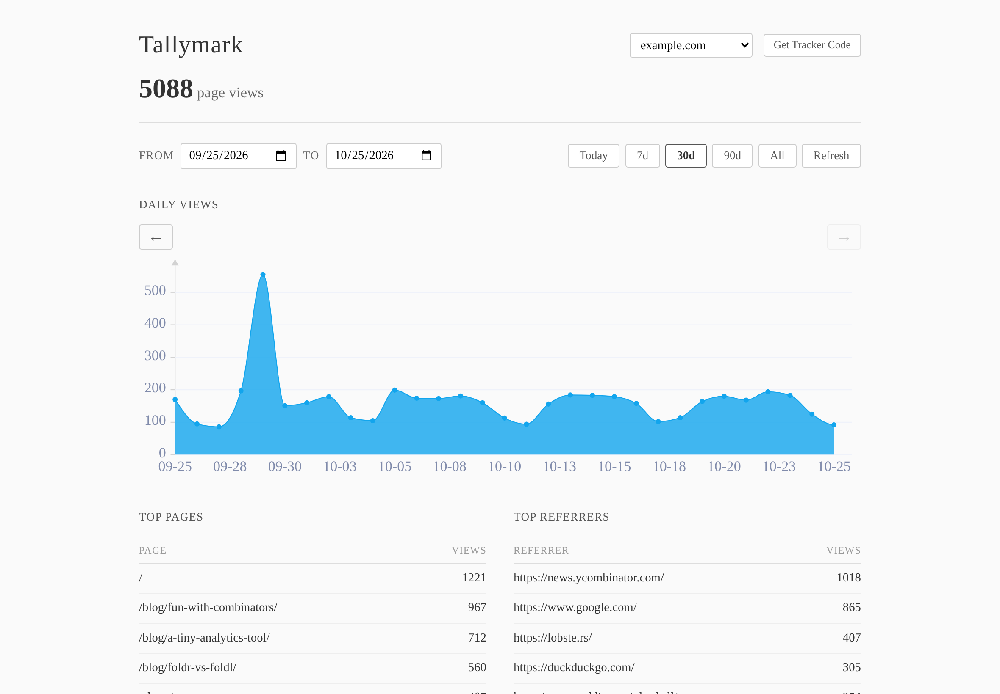

# Tallymark

Tiny, privacy-respecting, self-hosted web analytics. No cookies, no user tracking, no fingerprinting: just page view counts and referrers, running in your own AWS account.

**Website & full deployment guide:** https://philcrissman.github.io/tallymark/



## Features

- **Private by design.** No cookies, no local storage, no identifiers. The tracker respects Do Not Track.
- **A ~20-line tracker.** Plain JavaScript using `navigator.sendBeacon`, with no dependencies.
- **A clean dashboard.** A daily views chart with hover details, top pages, top referrers, and quick date ranges.
- **Multi-site.** One deployment serves many sites, with an allowlist for the site IDs it accepts.
- **Serverless and cheap.** Lambda + API Gateway + on-demand DynamoDB. A personal site typically costs well under $1/month.

## Stack

- **Backend**: Haskell on AWS Lambda (custom runtime via [hal](https://github.com/Nike-Inc/hal))
- **Frontend**: [Elm](https://elm-lang.org/) SPA with [elm-charts](https://github.com/terezka/elm-charts)
- **Database**: DynamoDB (single-table design, pay-per-request)
- **Tracker**: ~20 lines of vanilla JS using `navigator.sendBeacon`
- **Infra**: AWS SAM (API Gateway + Lambda + DynamoDB + S3)

## Quick start

You need an AWS account, the [AWS CLI](https://aws.amazon.com/cli/) and the [AWS SAM CLI](https://docs.aws.amazon.com/serverless-application-model/latest/developerguide/install-sam-cli.html).

**From a release** (no build tools needed):

```bash
curl -LO https://github.com/philcrissman/tallymark/releases/latest/download/tallymark.tar.gz
tar xzf tallymark.tar.gz && cd tallymark-*
cp tallymark.env.example tallymark.env   # set TALLYMARK_API_KEY and TALLYMARK_ALLOWED_SITES
./scripts/deploy.sh
```

**From source** (also needs Docker and Elm 0.19.1):

```bash
git clone https://github.com/philcrissman/tallymark.git && cd tallymark
cp tallymark.env.example tallymark.env   # edit it
make deploy                              # builds backend + dashboard, then deploys
```

The deploy script prints your dashboard URL. Sign in with your API key, click **Get Tracker Code**, and paste the snippet into your site.

See the [deployment guide](https://philcrissman.github.io/tallymark/deploy.html) for credentials setup, configuration options, updating, costs, security notes, uninstalling and troubleshooting.

## Configuration

`scripts/deploy.sh` reads these from the environment or from `tallymark.env` (git-ignored):

| Variable | Default | Purpose |
|---|---|---|
| `TALLYMARK_API_KEY` | *required* | Bearer token for the dashboard and stats API (`openssl rand -hex 32`) |
| `TALLYMARK_ALLOWED_SITES` | empty (any) | Comma-separated site IDs accepted by `/track` |
| `TALLYMARK_STACK_NAME` | `tallymark` | CloudFormation stack name |
| `TALLYMARK_REGION` | `us-east-1` | AWS region |
| `TALLYMARK_TABLE_NAME` | generated | Optional fixed DynamoDB table name (to adopt an existing table) |
| `TALLYMARK_DASHBOARD_BUCKET` | generated | Optional fixed S3 bucket name (must be globally unique) |

The DynamoDB table has `DeletionPolicy: Retain`, so deleting or replacing the stack never drops your data.

## Architecture

```
Browser ──POST /track──> API Gateway ──> Lambda ──> DynamoDB
                                                        │
Dashboard ──GET /stats──> API Gateway ──> Lambda ────────┘
            GET /sites
            DELETE /sites
```

The tracker sends a single POST on each page load with the URL path, referrer and site ID. Nothing else is collected and nothing is stored in the browser. The dashboard is a static Elm SPA served from S3. It authenticates with a Bearer token and reads its API URL from `config.js`, which the deploy script writes.

### DynamoDB key design (multi-site)

| Item type | pk | sk |
|---|---|---|
| Page view | `SITE#<siteId>#PAGE#<path>` | `TS#<timestamp>#<uuid>` |
| Site registry | `SITES` | `SITE#<siteId>` |

**GSI (ByDate)**: `gsi1pk = SITE#<siteId>#MONTH#<yyyy-mm>`, `gsi1sk = DATE#<timestamp>#<uuid>`

### API endpoints

| Method | Path | Auth | Description |
|---|---|---|---|
| `POST` | `/track` | None | Record a page view |
| `GET` | `/stats?site=&start=&end=` | Bearer | Get aggregated stats |
| `GET` | `/sites` | Bearer | List all tracked sites |
| `DELETE` | `/sites?site=` | Bearer | Delete all data for a site |

## Local development

```bash
make local-setup    # DynamoDB Local via Docker + create the table
make local-seed     # ~70 sample page views over 14 days for example.com
make local-api      # build the backend in Docker and run `sam local start-api` on :3000
make local-test     # send a test page view and fetch stats

make build-dashboard
cd dashboard/build && python3 -m http.server 8080
```

Open `http://localhost:8080/?api=http://localhost:3000` and sign in with `localdevkey` (set in `local-env.json`).

### Build notes

- The backend builds in Docker using `utdemir/ghc-musl:v25-ghc944`, producing a statically linked x86_64 `bootstrap` binary (also on ARM Macs, via `--platform linux/amd64`). The build uses **Cabal**; `cabal.project` has `allow-newer: all` for amazonka 2.0.
- SAM only passes env vars declared in the template's `Environment.Variables` to the Lambda container.
- The template must use `AWS::Serverless::Api` (REST API v1), **not** `HttpApi` (v2), because hal expects the v1 event format.
- `make local-api` uses `--docker-network tallymark_default` so the Lambda container can reach DynamoDB Local.

## Releases

Pushing a `v*` tag runs `.github/workflows/release.yml`. It builds the backend and dashboard and attaches `tallymark-<version>.tar.gz` (plus a stable `tallymark.tar.gz` and `function.zip`) to a GitHub release. To build the bundle locally, run `make release`.

## Project structure

```
tallymark/
├── Makefile                    # Build, deploy and local dev automation
├── tallymark.env.example       # Deploy settings template
├── docker-compose.yml          # DynamoDB Local
├── local-env.json              # Local Lambda env vars
├── backend/                    # Haskell Lambda (Cabal, built in Docker)
│   └── src/
│       ├── Main.hs             # Handler, routing, auth
│       └── Analytics/          # Types, DynamoDB access, track & stats handlers
├── dashboard/                  # Elm SPA
│   ├── index.html, style.css, config.js
│   └── src/                    # Main.elm, Api.elm, Chart/Visits.elm
├── tracker/tracker.js          # Reference tracker script
├── infra/template.yaml         # SAM/CloudFormation template
├── scripts/                    # build, deploy, release packaging, local DB helpers
└── site/                       # Project website (GitHub Pages)
```

## Contributing

Issues and pull requests are welcome. See [CONTRIBUTING.md](CONTRIBUTING.md).

## License

[AGPL-3.0](LICENSE). You're free to use, modify and self-host Tallymark. If you run a modified version as a network service for others, you must make your source available to them.
